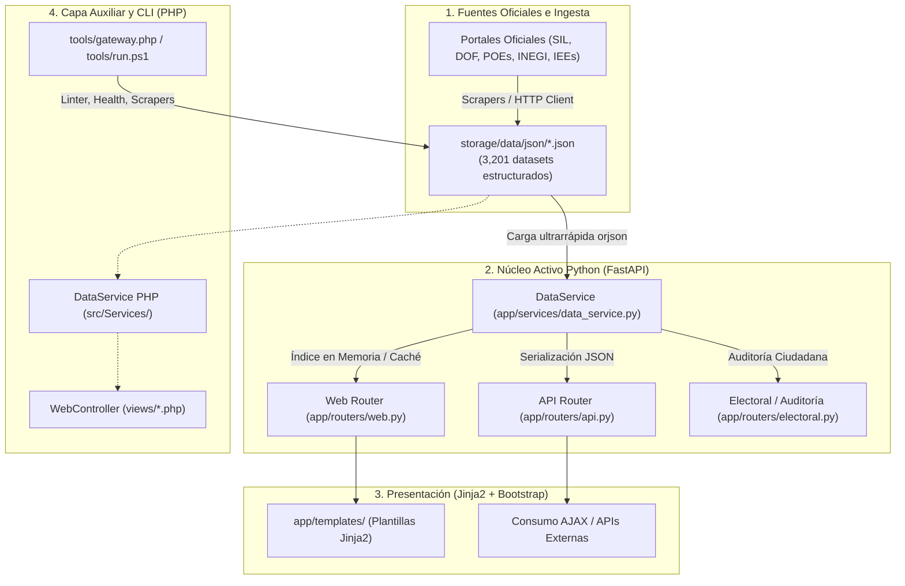

# Arquitectura de Pulso Cívico

## Principios de Diseño
1. **Rendimiento Nativo y Low-Cost**: Servidor web asíncrono en **Python (FastAPI + Jinja2 + orjson)** para tiempos de respuesta ultra-rápidos (< 15 ms) con bajo consumo de memoria. Cero bases de datos complejas (sin SQL pesados); toda la información vive en archivos JSON estructurados y versionados en Git.
2. **Trazabilidad y Evidencia**: Cada registro político posee un hash criptográfico SHA-256 (`sha256_evidencia`) vinculado a fuentes oficiales primarias (`.gob.mx`, POEs, DOF, SIL, INEGI, INE).
3. **Separación de Capas**: El frontend jamás accede a datos directos sin pasar por los servicios de repositorio (`DataService`), garantizando sanitización, normalización de partidos y cálculo de facetas.
4. **Dualidad y Resiliencia**: Capa primaria en Python para servicio web/API, y capa auxiliar en PHP 8.1+ para herramientas CLI de auditoría, runner unificado y scrapers históricos.

---

## Flujo de Datos del Sistema



---

## Estructura del Proyecto

```text
app/                     Núcleo activo de la aplicación en Python (FastAPI)
  core/                  Configuración (config.py) y seguridad / rate limit (security.py)
  routers/               Rutas web (web.py), API REST (api.py) y auditoría (electoral.py)
  services/              Lógica de datos (data_service.py), auditoría (audit_service.py), educación (education_service.py)
  templates/             Vistas Jinja2 (home.html, politico.html, layouts y partials)

storage/                 Almacenamiento estático de datos abiertos y assets
  data/json/             Datasets cívicos publicados (3,201 JSONs / 33,368 registros)
    municipios/          Historial electoral de 54 años y cabildos (2,474 JSONs)
    ejecutivo/           Gobernadores de 32 estados y CDMX (34 JSONs / 300 reg.)
  raw/photos/            Fotografías oficiales de legisladores (distribuidas por pack externo)
  cache/                 Caché de índices y páginas compiladas (ignorado en git)

tools/                   Herramientas de línea de comandos, runner y scrapers
  run.ps1                Runner centralizado multiplataforma
  gateway.php            CLI universal de inspección, linting y scrapers
  core/                  Linter, GitOps, Inspector, CatalogBuilder, DataIntegrityAudit

src/                     Capa legacy / contingencia en PHP
  Controllers/           WebController, MunicipioController, AuditController
  Services/              DataService, IngestServices, Scrapers
  Core/                  Router, HttpClient, Logger, ViewHelper, PageCache

views/                   Plantillas PHP legacy (contingencia / hosting compartido)
requirements.txt         Dependencias Python (FastAPI, uvicorn, jinja2, orjson, pydantic)
```

---

## Rutas Web Principales

| Ruta | Motor | Descripción |
|---|---|---|
| `/` | FastAPI + Jinja2 | Portada interactiva, métricas nacionales, mapa cívico y buscador global (`Ctrl+K`) |
| `/politicos`, `/politicos/{slug}` | FastAPI + Jinja2 | Directorio nacional y expediente individual con historial de legislaturas y partidos |
| `/legislaturas`, `/legislaturas/{num}` | FastAPI + Jinja2 | Explorador histórico parlamentario (LXI a LXVI) |
| `/alcaldes`, `/municipios` | FastAPI + Jinja2 | Directorio de 2,474 presidentas y presidentes municipales en funciones |
| `/municipios/{cvegeo}` | FastAPI + Jinja2 | Expediente municipal con 54 años de elecciones (1970–2024) y cabildo |
| `/estados/{slug}` | FastAPI + Jinja2 | Ficha estatal (gobernador, congreso local y legisladores federales) |
| `/comisiones`, `/comisiones/{slug}` | FastAPI + Jinja2 | Comisiones legislativas y composición de integrantes |
| `/estudios`, `/estudios/{categoria}` | FastAPI + Jinja2 | Análisis de paridad de género, pluralidad y escolaridad parlamentaria |
| `/api/buscar`, `/api/politicos` | FastAPI (JSON) | API de autocompletado y búsqueda parametrizada |
| `/sitemap.xml`, `/llms.txt` | FastAPI | Indexación SEO y contexto para agentes de Inteligencia Artificial |

---

## Seguridad Zero-Trust y Resiliencia
- **Rate Limiting por IP**: Middleware nativo en `app/core/security.py` para protección contra abusos y scraping no autorizado.
- **Cero Secretos en Repositorio**: Variables de entorno sensibles (`TELEGRAM_BOT_TOKEN`, claves privadas) aisladas en `.env` (ignorado en `.gitignore`).
- **Aislamiento de Binarios Pesados**: Las más de 4,000 fotos de legisladores se excluyen del repositorio y se distribuyen vía almacenamiento externo, preservando un repositorio liviano.
- **Protección de Rutas**: `.htaccess` bloquea el acceso HTTP directo a archivos de configuración, logs y datasets crudos.
