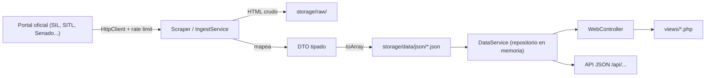

# Arquitectura de Pulso Cívico

## Principios
1. **Low-cost**: sin frameworks, sin Composer, sin base de datos. Corre en cualquier hosting PHP barato.
2. **Datos trazables**: todo registro conserva su fuente oficial.
3. **Capas separadas**: las vistas nunca leen archivos ni llaman a portales externos directamente.

## Flujo de datos



## Estructura de carpetas
```
index.php            Front controller web (único punto de entrada)
config/config.php    Configuración (lee .env)
src/
  Core/              Router, HttpClient, Logger, ViewHelper, PageCache
  Controllers/       WebController (rutas generales), MunicipioController (alcaldes y municipios)
  DTO/               LegisladorDTO, VotacionDTO, SesionPlenoDTO
  Services/          DataService (lectura unificada), EducationService (análisis estadístico)
views/               Plantillas (layout/, partials/, páginas por módulo)
storage/
  data/json/         Datasets finales publicados (3,201 JSONs / 33,368 registros)
    alcaldes/        Directorio nacional de alcaldes vigentes (2,474 municipios)
    municipios/      Historial de 54 años y cabildos por cvegeo (2,474 JSONs)
    ejecutivo/       Gobernadores de 32 estados y CDMX (34 JSONs / 300 reg.)
  raw/photos/        Fotos oficiales de legisladores y mandatarios
  raw/html/          Descargas crudas de respaldo
tools/
  gateway.php        CLI universal: php tools/gateway.php <accion>
  run.ps1            Atajo Windows hacia gateway.php
  core/              Linter, GitOps, Inspector, CatalogBuilder, BuildDirectoryIndex

## Rutas web
| Ruta | Descripción |
|---|---|
| `/` | Portada con observatorio, métricas nacionales y mapa interactivo |
| `/legislaturas`, `/legislaturas/{id}` | Explorador de legislaturas federales (LVII a LXVI) |
| `/politicos`, `/politicos/{slug}` | Directorio de políticos y ficha con trayectoria histórica |
| `/alcaldes`, `/municipios` | Directorio nacional de alcaldes vigentes (2,474 municipios) |
| `/municipios/{cvegeo}` | Ficha municipal con historial electoral de 54 años y cabildo |
| `/estados/{slug}` | Ficha estatal (gobernador, congreso local y legisladores federales) |
| `/comisiones`, `/comisiones/{slug}` | Comisiones legislativas |
| `/estudios`, `/estudios/{categoria}` | Estadísticas de paridad, pluralidad y productividad |
| `/api/buscar`, `/api/politicos`, `/api/alcaldes` | API JSON de consulta |
| `/sitemap.xml`, `/sitemap-*.xml`, `/llms.txt` | Indexación SEO y contexto para agentes de IA |

## Seguridad
- `.htaccess` bloquea `src/`, `tools/`, `config/`, `storage/` (salvo fotos), dotfiles y logs.
- Toda salida en vistas se escapa con `ViewHelper::e()`.
- Configuración sensible solo en `.env` (nunca versionado).

## Deuda técnica conocida (buenas tareas para voluntarios)
- Archivos grandes por dividir: `SilIngestService.php`, `DataService.php`, `EducationService.php`, `views/politico.php`.
- Autoloader PSR-4 duplicado en varios archivos → centralizar en `src/bootstrap.php`.
- Falta `ScraperInterface` común para nuevas fuentes.
- Sin tests automatizados ni CI.
- `index.old.php` y `app.php` son legacy; `views/layout/header.php` referencia `assets/og-cover.png` inexistente.
