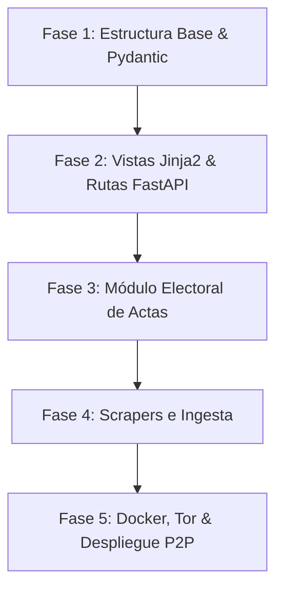

# Plan de Migración de Pulso Cívico: PHP a Python + Red P2P y Auditoría Electoral

## 1. Visión y Objetivos de la Migración
1. **Transición sin pérdida de datos:** Preservar intactos los datasets JSON existentes en `storage/data/json/` y las fotos en `storage/raw/photos/`.
2. **Arquitectura Asíncrona y Modular en Python:** Uso de **FastAPI** para servir las vistas web (vía Jinja2) y los endpoints API JSON con alto rendimiento y tipado estricto (Pydantic).
3. **Módulo de Auditoría Electoral Ciudadana:** Permitir la subida descentralizada de actas/sábanas de votación, validación de integridad (hashes SHA-256/firmas criptográficas) y lectura OCR futura.
4. **Resistencia a Censura y Distribución:** Integración de cliente Tor (via `Stem` / SOCKS) y empaquetado **Docker / Docker Compose** para despliegue de nodos réplica con un solo comando.

---

## 2. Equivalencias Técnicas (PHP vs Python)

| Capa / Componente | Implementación Actual (PHP 8.1+) | Nueva Implementación (Python 3.11+) |
|---|---|---|
| **Servidor Web & API** | Router nativo en `src/Core/Router.php` | **FastAPI** + **Uvicorn** (asíncrono, ASGI) |
| **Motor de Vistas** | Plantillas PHP nativas en `views/*.php` | **Jinja2** (sintaxis casi idéntica a plantillas estándar) |
| **Contratos de Datos** | DTOs tipados en `src/DTO/` | Modelos **Pydantic v2** (`BaseModel`) |
| **Repositorio / Servicios** | `DataService.php` | `DataService` (asíncrono, caché en memoria con `orjson`) |
| **Scrapers e Ingesta** | `src/Core/HttpClient.php` + `DOMDocument` | **httpx** (asíncrono) + **BeautifulSoup4** / **Selectolax** |
| **CLI / Runner** | `tools/gateway.php` + `tools/run.ps1` | `cli.py` con **Typer** o **Click** |
| **Contenedor / Nodo** | Apache / XAMPP local | **Docker Compose** (FastAPI + Tor daemon) |

---

## 3. Fases de Ejecución



### Fase 1: Arquitectura Base y Modelos Pydantic
* Crear la estructura de carpetas Python:
  ```text
  app/
    ├── core/          (config.py, security.py, logger.py)
    ├── schemas/       (legislador.py, votacion.py, acta.py - Pydantic)
    ├── services/      (data_service.py, electoral_service.py)
    ├── routers/       (web.py, api.py, electoral.py)
    ├── templates/     (migración de views/*.php a .html con Jinja2)
    └── static/        (css, js, assets existentes)
  ```
* Configurar `pyproject.toml` o `requirements.txt` sin dependencias innecesarias (`fastapi`, `uvicorn`, `jinja2`, `pydantic`, `httpx`, `pillow`, `stem`).
* Migrar los DTOs de `src/DTO/` a esquemas Pydantic que validen los JSON existentes sin romper retrocompatibilidad.

### Fase 2: Servicios de Datos y Vistas Web
* Implementar `DataService` en Python:
  * Lectura eficiente de los JSON de `storage/data/json/`.
  * Indexación en memoria para búsquedas instantáneas por estado, slug o partido.
* Migración de plantillas:
  * Convertir `views/layout/main.php` en `app/templates/layout/base.html`.
  * Migrar las páginas clave (`inicio.php`, `diputados.php`, `senadores.php`, `detalle.php`).
* Configurar rutas en `routers/web.py` replicando exactamente las URLs actuales:
  * `/`
  * `/politicos/{slug}`
  * `/estados/{slug}`
  * `/api/buscar`, `/api/estados/{slug}`

### Fase 3: Módulo de Auditoría Electoral (Casillas y Actas)
* **Recepción Segura de Fotos de Actas:**
  * Endpoint `POST /api/electoral/actas`: subida anónima de fotos de casillas (JPG/PNG/WEBP).
  * Limpieza estricta de metadatos EXIF con `Pillow` (para no revelar ubicación, modelo de teléfono ni datos personales del ciudadano que tomó la foto).
  * Generación de hash SHA-256 del archivo como comprobante de inmutabilidad.
* **Organización de Datos Electorales:**
  * Guardado estructurado: `storage/electoral/actas/{seccion}_{casilla}_{hash}.webp`.
  * Creación de metadatos JSON firmados listos para replicación entre nodos.

### Fase 4: Scrapers y Tareas CLI
* Migración progresiva de scrapers:
  * Priorizar `SilIngestService` y `ParliamentScraperService` usando `httpx` con soporte nativo de rate limiting.
* Crear `cli.py` para sustituir `tools/gateway.php`:
  * `python cli.py ingest federal`
  * `python cli.py health`
  * `python cli.py export-static`

### Fase 5: Empaquetado Docker, Servicio Oculto Tor y Nodos Réplica
* Crear `Dockerfile` ligero basado en `python:3.11-slim`:
  * Instalación de Tor y FastAPI.
  * Configuración de usuario no-root por seguridad.
* Crear `docker-compose.yml`:
  * Servicio `web` (FastAPI).
  * Servicio `tor` (genera automáticamente el dominio `.onion` y enruta al puerto web).
  * Volumen montado para `storage/` para que los nodos compartan los datos persistentes.
* Documentar la guía de nodo voluntario: un colaborador (ej. Liyo) clona el repo, ejecuta `docker compose up -d` y su nodo ya está en línea sirviendo y recibiendo datos.

---

## 4. Estrategia de Convivencia y Cero Riesgo
* **No borrar el código PHP de golpe:** El código Python se desarrolla en paralelo (por ejemplo en la carpeta `app/` o en una rama dedicada `feature/python-core`).
* Ambas implementaciones pueden correr leyendo exactamente la **misma carpeta `storage/data/json/`**.
* Cuando la suite de Python iguale en rutas y funcionalidades a PHP, se realiza el switch definitivo.
